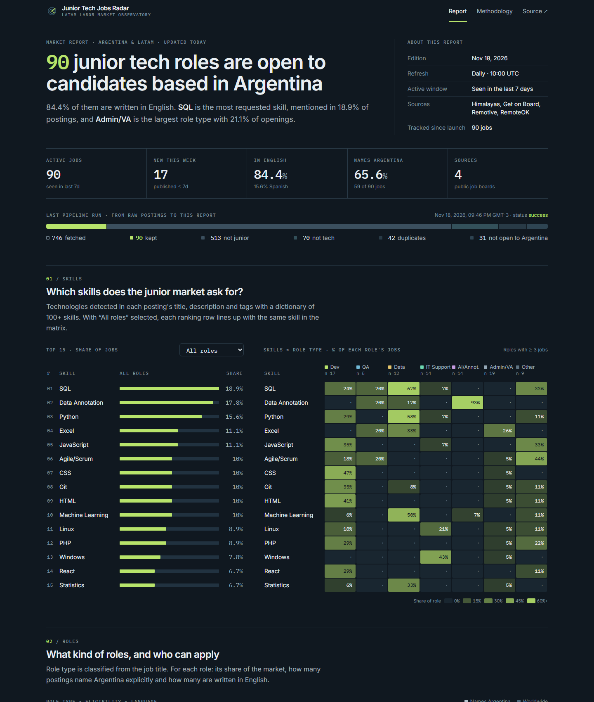
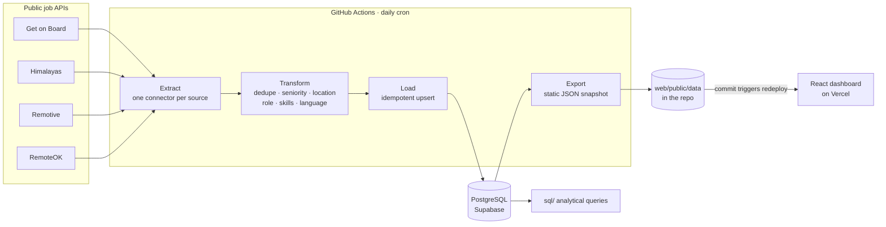

<div align="center">

# Junior Tech Jobs Radar

**An automated data pipeline and market report that tracks junior and entry-level tech jobs open to candidates in Argentina and LATAM.**

[](https://github.com/lucaswsanchez/junior-tech-jobs-radar/actions/workflows/ci.yml)
[](https://github.com/lucaswsanchez/junior-tech-jobs-radar/actions/workflows/pipeline.yml)
[](LICENSE)


### [🔗 Live demo](https://junior-tech-jobs-radar.vercel.app) · [📐 Methodology](https://junior-tech-jobs-radar.vercel.app/methodology) · [📋 Project board](https://github.com/users/lucaswsanchez/projects/1)



</div>

## Live demo

The dashboard is a static site, so it loads instantly (no backend cold start). Its data is
refreshed every day by GitHub Actions.

> **[junior-tech-jobs-radar.vercel.app](https://junior-tech-jobs-radar.vercel.app)**: open it, no sign-up needed. Data is stored in Supabase PostgreSQL and refreshed daily at 10:00 UTC.

## Features

- **Daily ETL** from four public job APIs: Get on Board, Himalayas, Remotive and RemoteOK.
- **Junior-only, Argentina-eligible filtering.** It uses the seniority field from the source, title rules and a
  "3+ years of experience" guard. It keeps jobs that name Argentina or are open to LATAM or worldwide.
- **Enrichment**: role type (Development, QA, Data, IT Support, AI/Annotation, Admin/VA, Other),
  **108 skills** detected with word-boundary regexes, and EN/ES language.
- **PostgreSQL warehouse** with an idempotent upsert and run metrics (`pipeline_runs`).
- **8 analytical SQL queries**: top skills by role, remote share, weekly trend, skill co-occurrence with lift, and more.
- **Market report dashboard**:
  - headline indicators and a pipeline funnel (746 postings fetched → 90 junior jobs kept on the first production run)
  - skills ranking and a skills × role heatmap
  - role × eligibility × language table, weekly trend and sources
  - a sortable, filterable job explorer, where every row links to the original posting
- **Methodology page** that explains every rule and metric.

## Tech stack

| Layer | Technologies |
| --- | --- |
| Pipeline | Python 3.12, httpx, pydantic v2, SQLAlchemy 2 (Core), psycopg 3 |
| Database | PostgreSQL (Supabase) · SQLite for local development |
| Automation | GitHub Actions (CI on every PR, daily cron pipeline) |
| Frontend | React 19, TypeScript, Vite, Tailwind CSS v4, Recharts, TanStack Table |
| Hosting | Vercel (static) |
| Quality | pytest + coverage, Vitest, Ruff, mypy (strict), oxlint, Prettier |
| Local stack | Docker Compose (optional) |

## Architecture



Each source is isolated: if one API fails, the run continues and is recorded as `partial` in
`pipeline_runs`. More detail in [`docs/decisions.md`](docs/decisions.md).

```
src/jobs_radar/
  extract/      # Source interface + 4 connectors (fetch = network, parse = pure)
  transform/    # seniority, location, dedupe, roles, skills, language, pipeline
  load/         # schema (SQLAlchemy Core) and repository (upsert, run metrics)
  export.py     # summary.json, skills.json, jobs_latest.json
  pipeline.py   # end-to-end run
  cli.py        # jobs-radar run | export | init-db | version
sql/            # documented analytical queries (PostgreSQL)
tests/          # pytest suite with saved API fixtures (no network)
web/            # React dashboard
```

## Getting started

### Without Docker (recommended)

Requirements: Python 3.12, Node 22+ and pnpm.

```bash
git clone https://github.com/lucaswsanchez/junior-tech-jobs-radar.git
cd junior-tech-jobs-radar

# Pipeline
python -m venv .venv
source .venv/bin/activate        # Windows: .venv\Scripts\activate
pip install -e ".[dev]"
jobs-radar run                   # no DATABASE_URL -> local SQLite at data/jobs.db

# Dashboard
cd web
pnpm install
pnpm dev                         # http://localhost:5173
```

`jobs-radar run` fetches live data and writes the snapshot to `web/public/data`. The repo already
includes a snapshot, so the dashboard also works without running the pipeline.

### With Docker

```bash
docker compose up --build
```

This starts PostgreSQL 16, runs the pipeline against it and serves the dashboard at
http://localhost:5173.

## Environment variables

| Variable | Default | Description |
| --- | --- | --- |
| `DATABASE_URL` | `sqlite:///data/jobs.db` | PostgreSQL connection string. In production, the Supabase **Session pooler** URL (IPv4, port 5432). |
| `REQUEST_DELAY_SECONDS` | `1.0` | Pause between requests to the same API. |
| `LOG_LEVEL` | `INFO` | `DEBUG`, `INFO`, `WARNING` or `ERROR`. |

Copy `.env.example` to `.env` for local overrides. In GitHub Actions, `DATABASE_URL` is a
repository secret.

## Running tests

```bash
pytest --cov=jobs_radar          # Python: parsers (offline fixtures), rules, load, export
ruff check . && ruff format --check . && mypy

cd web
pnpm test                        # Vitest: filtering and analytics helpers
pnpm lint && pnpm build
```

CI runs **164 Python tests** (including the load tests and every SQL query against a PostgreSQL 16
service) and **13 frontend tests** on every pull request. The `transform` package has
**100% coverage**.

## Methodology

The filtering rules, classification and metrics are documented in the app's **Methodology** page and in
[`docs/decisions.md`](docs/decisions.md). Analytical queries live in [`sql/`](sql/README.md).

## Project management

The project was planned and delivered with a lightweight agile workflow on GitHub:

- **[Kanban board](https://github.com/users/lucaswsanchez/projects/1)** (Backlog → In progress → Done)
  with user stories written as issues ("As a … I want … so that …"), each with acceptance criteria.
- Two milestones: **MVP** (pipeline, database, automation, dashboard) and **Polish** (Docker,
  docs, deployment, redesign).
- **One branch and one pull request per story.** Each PR closes its issue (`Closes #N`), is
  squash-merged, and only merges with green CI.
- **Conventional Commits** (`feat:`, `fix:`, `docs:`, `test:`, `ci:`, `chore:`).

## Roadmap

- [ ] Persist daily snapshots to chart skill demand over time, not only postings per week.
- [ ] Add more public sources with LATAM coverage.
- [ ] Salary ranges when the source provides them.
- [ ] Email or RSS digest of new junior roles by skill.
- [ ] Optional country-level eligibility, by querying each LATAM country separately.

## Lessons learned / technical decisions

1. **Static snapshot over a backend.** The data changes daily, so a committed JSON snapshot gives
   instant loads and zero servers, with no free-tier cold starts.
2. **Pure parsers + isolated sources.** Splitting `fetch` (network) from `parse` (pure) made every
   connector testable with saved fixtures, and a failing API only degrades a run to `partial`.
3. **Explainable rules beat a model here.** With no labelled data, ordered regex rules and a skill
   dictionary can be explained on the Methodology page and pinned by unit tests. Ambiguous words
   like "Go", "R" or "React" needed special handling.
4. **One upsert, two databases.** A dialect-aware `ON CONFLICT` upsert runs on SQLite locally and on
   PostgreSQL in production. CI tests both.
5. **Measure the layout, don't eyeball it.** The redesign was audited by measuring element
   positions in the DOM at four widths. That found a mobile overflow and made the skills ranking
   and matrix rows line up exactly.

## Author

**Lucas Sanchez** · Systems Analyst · Corrientes, Argentina

[LinkedIn](https://linkedin.com/in/lucaswsanchez) · [GitHub](https://github.com/lucaswsanchez) · [Portfolio](https://lucassanchez.netlify.app)

## License

[MIT](LICENSE)
